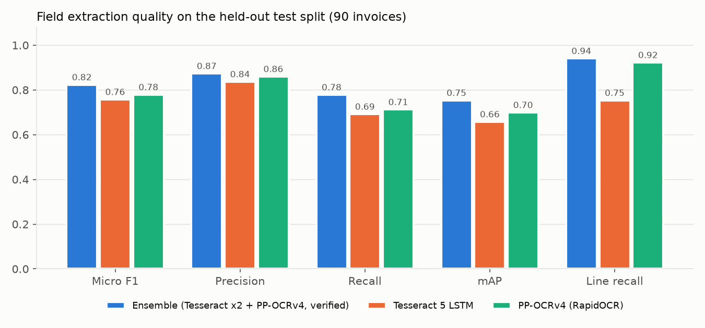
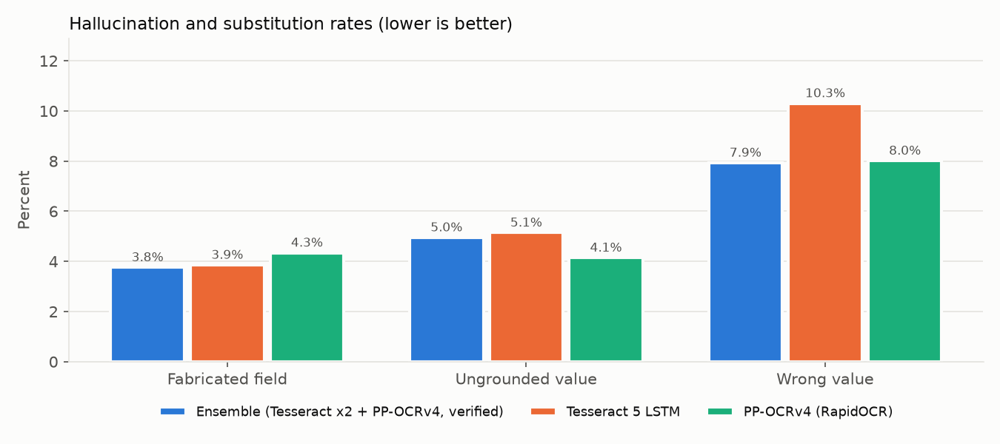
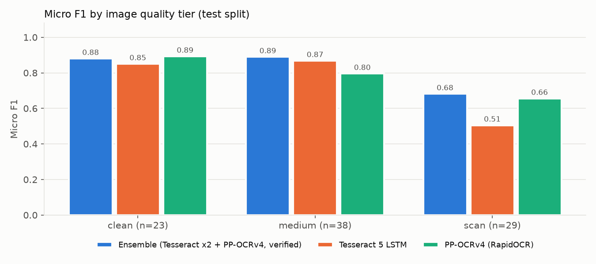
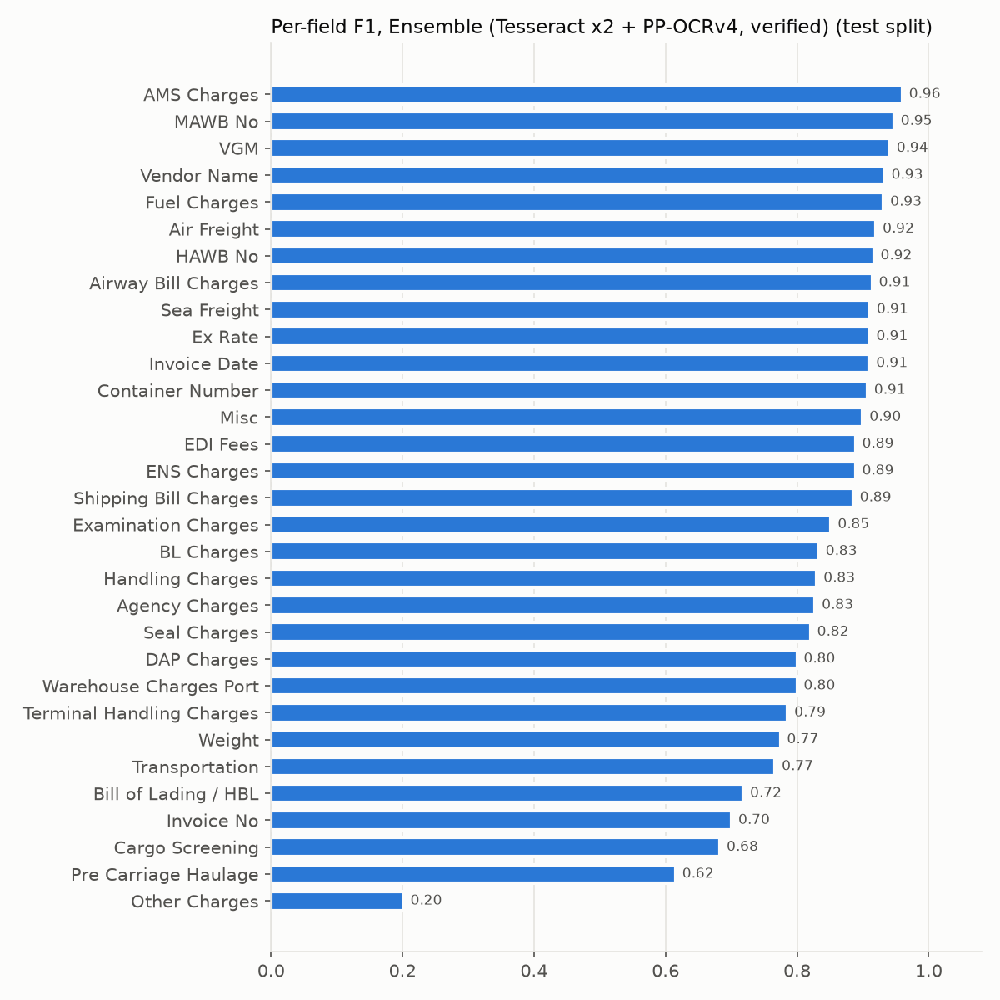

# Freight Invoice Extractor: Design and Evaluation

Scope: extract the 31 requested fields from freight-forwarding invoices (mostly raster) into a fixed JSON contract, and measure it on a synthetic benchmark built with the repo's invoice maker.

## 1. Summary

| | Held-out test split (90 invoices, 86% raster) |
|---|---|
| Recommended pipeline | OCR ensemble (Tesseract 5 LSTM x2 + PP-OCRv4) with arithmetic/check-digit verification, layout parser, semantic charge mapper |
| Micro F1 (95% CI) | **0.823** (0.790 to 0.853) |
| Precision / Recall | 0.873 / 0.778 |
| mAP (confidence-ranked, DocILE style) | 0.753 |
| Fabricated fields | 3.8% of predicted values (CI 2.9% to 4.8%) |
| Ungrounded values (not printed anywhere on the page) | 5.0% (CI 3.0% to 7.3%) |
| Output structure obedience | 100% (every file has exactly the 31 keys, correct types, `""` for absent) |
| Charge-line recall / precision | 0.941 / 0.949 |
| Latency, 4 vCPU, no GPU | 6.1 s mean, 17.5 s worst case per page |

Dev (60 invoices, used for all tuning) scored micro F1 0.829. Test scored 0.823, so there is no sign that tuning overfit the dev split.

What the numbers say, in plain terms:

1. On clean and medium-quality pages the pipeline reaches F1 about 0.88 to 0.89. On 150-DPI scans it drops to 0.68. OCR is the binding constraint there.
2. The pipeline copies every value from the page. It never generates a number. Most "hallucination" it shows is misattribution (a real printed value put in the wrong field), plus charges put into "Other Charges" when the wording is unfamiliar.
3. The largest remaining error is semantic. Charge wordings the lexicon has seen are classified correctly 95.1% of the time. Wordings it has never seen are classified correctly 64.4% of the time, and the rest land in "Other Charges" (F1 0.20). An LLM that only picks a category for those lines (implemented, see section 7) is the targeted fix. It could not be benchmarked here.

## 2. Why this model combination, and what could not be tested

research.md recommends Docling (digital PDFs) + HunyuanOCR (scans) + Qwen3-VL 8B (semantic mapping). That stack needs model weights from HuggingFace and Ollama. This build environment's network policy blocks both (HTTP 403), so none of those three models could be run or measured here. The code keeps that path (`--backend llm`, `--ocr hunyuan`) so it can be benchmarked on the Mac with the same harness.

Two things in research.md limit how far its numbers can decide the stack for this task:

* Its F1/precision/recall are word-level OCR/markdown fidelity on 8 invoices (18 pages). This task is field-level extraction plus semantic mapping, which is a different measurement. With 18 pages the confidence intervals are wide (for example, a 33.3% repetition rate is 6 of 18 pages, 95% interval about 13% to 59%).
* The "99.2% pipeline accuracy" for the Docling + Hunyuan hybrid has no measurement behind it in the report.

What could be measured here, on the same 90 test invoices:

| Configuration | Micro P | Micro R | Micro F1 (95% CI) | mAP | Fabricated | Ungrounded | Wrong value | Line recall | Mean latency |
|---|---|---|---|---|---|---|---|---|---|
| **Ensemble, verified** (recommended) | 0.873 | 0.778 | **0.823** (0.790 to 0.853) | 0.753 | 3.8% | 5.0% | 7.9% | 0.941 | 6.1 s |
| Tesseract 5 LSTM only | 0.837 | 0.692 | 0.757 (0.709 to 0.804) | 0.658 | 3.9% | 5.1% | 10.3% | 0.753 | 1.7 s |
| PP-OCRv4 (RapidOCR) only | 0.860 | 0.712 | 0.779 (0.745 to 0.814) | 0.699 | 4.3% | 4.1% | 8.0% | 0.922 | 5.5 s |




The two OCR engines fail differently. Tesseract keeps word spaces but loses digits on degraded scans and table headers. PP-OCRv4 reads digits well but drops the spaces between words ("TerminalHandlingCharges"). The ensemble exploits the invoice's own redundancy to choose between readings instead of trusting one engine:

* Each charge line is cross-checked by independent arithmetic paths: printed column value, $q \cdot r \cdot \text{ROE}$, $T/(1+g)$ and $T-\text{GST}$. The amount supported by the most paths wins.
* The table whose lines reconcile with the printed subtotal, $\left|\sum_i a_i - S\right| \le 1$ INR, is preferred.
* Container numbers must pass the ISO 6346 check digit and MAWB numbers the mod-7 check, so a union across readings is safe.
* Header fields are decided by a confidence-weighted vote across readings.
* PP-OCRv4 (the slow reading) runs only when no Tesseract reading reconciles its table.



| Micro F1 by tier (test) | Clean (n=23) | Medium (n=38) | Scan (n=29) |
|---|---|---|---|
| Ensemble | 0.880 | 0.890 | 0.682 |
| Tesseract only | 0.850 | 0.868 | 0.505 |
| PP-OCRv4 only | 0.893 | 0.796 | 0.656 |

## 3. Pipeline

```
PDF / image
  ├─ digital PDF page ──► PyMuPDF words + boxes (exact text, no OCR)
  └─ raster page ──► deskew (projection profile) ─► denoise if noisy ─► upscale to ~2600 px
                     ─► invert white-on-dark bands ─► illumination normalisation
                     ─► readings: Tesseract (rules erased), Tesseract (raw), [PP-OCRv4 if unverified]
word boxes ─► visual rows and cells (character-width gaps, skew-tolerant chaining)
  ├─ header: label synonym lexicon with negative contexts ("Party Invoice No", "Due Date")
  │          value inline / right / below, field validators (dates day-first, ISO 6346, MAWB mod 7)
  ├─ vendor: largest top-of-page company phrase, confirmed by the "For <company>" signature line
  └─ charges table: header roles ─► data-gutter columns ─► order-preserving DP alignment of
                    headers to columns ─► row parsing (skip subtotals, stop at taxes)
                    ─► arithmetic voting per line ─► subtotal reconciliation
charge description ─► semantic mapper ─► 22 categories ─► summed per output field (INR, pre-GST)
─► strict output contract (31 keys, numbers or "", ISO dates) + audit sidecar (confidence, evidence)
```

Semantic mapping of charge descriptions (the "NLP" part):

1. The alias lexicon in `schema.py`. It was written before this dataset existed (commit `5ecbf12`) and was only extended for dev-set errors on *seen* wordings. Each addition is commented in the code.
2. Generic normalisation. This covers dotted acronyms (`S.B.` to `SB`), freight abbreviations (`Hdlg`, `Chgs`), singularisation, camel-case splitting, and dictionary word segmentation for run-together OCR text. It also repairs OCR spelling against the lexicon vocabulary, but never "repairs" a real English word ("cleaning" stays "cleaning").
3. Head-noun precedence. Text outside parentheses beats text inside, so "Road Transport (Factory to CFS)" is transport, not CFS storage.
4. A mode-aware rule for bare "freight": sea or air, from the shipment's transport evidence.
5. Anything without evidence goes to "Other Charges" with basis `default`. That is the hook for the LLM classifier (`--backend layout+llm`).

## 4. Dataset

Built by driving `invoice-maker.html` headlessly (`dataset/build_dataset.py`). The maker gained a new document type, "Freight Forwarding Invoice (31 fields)", with:

* **Modes:** sea FCL, sea LCL, air, and customs clearance.
* **Eight visually distinct templates:**

  | ID | Name | Distinguishing trait |
  |---|---|---|
  | T1 | classic box | |
  | T2 | banner + key/value | |
  | T3 | dot-matrix monospace | |
  | T4 | modern minimal | borderless |
  | T5 | 13-column wide | non-GST column |
  | T6 | sectioned | section subtotals |
  | T7 | key/value grid | foreign currency inline in descriptions |
  | T8 | serif narrative | ordinal dates, labels inside sentences |

* **Varied wording:** synonym header labels and 2 to 10 wordings per charge category.
* **Realistic data:** valid container and MAWB check digits, and distractors (party invoice numbers, due and sailing dates, seal numbers, MBL next to HBL, chargeable vs gross weight, bill-to company names).
* **Ground truth:** the 31-field record and per-line categories for every invoice.

| | |
|---|---|
| Invoices | 150 (dev 60, test 90) |
| Raster share | 86% (JPG 80, image-only PDF 39, PNG 10) plus 21 digital PDFs |
| Quality tiers | clean 37, medium 67 (about 170 DPI, blur, JPEG 70 to 85), scan 46 (about 150 DPI, skew up to 2.5 degrees, perspective, uneven light, noise, 20% binarised, JPEG 50 to 70) |
| Modes | sea FCL 60, air 44, sea LCL 24, clearance 22 |
| Charge lines | 1,094, of which 299 (27%) use a **held-out wording** |
| Header labels | 192 of 881 use a **held-out label** |
| Unseen layouts | T7 and T8 appear only in test |

Held-out wordings and labels never appear verbatim in the extractor's rules. `tests/test_extractor.py::test_no_heldout_wording_in_extractor_lexicon` enforces this.

Scan-tier calibration: a first version at about 100 DPI was not legible to a human reader, and both engines fell to about 0.2 token recall. It was re-set to about 150 DPI (a cheap office scanner) before any extractor tuning.

## 5. Metric definitions

Per field and document: a correct value is a TP. A missing value is an FN. A value where the document has none is an FP (a "fabricated field"). A wrong value counts once as FP and once as FN.

Matching rules:

* Money must match to the paisa, $|\Delta| \le 0.01$.
* Ex Rate $|\Delta| \le 10^{-4}$, weight $|\Delta| \le 0.01$ kg.
* IDs compare upper-case alphanumerics.
* Dates compare in ISO form.
* Vendor names are case and punctuation folded.
* Containers compare as a set.

The metrics:

* **Micro P/R/F1** over all field instances. **Macro F1** is the mean over fields.
* **mAP**: per field, predictions ranked by the pipeline's own confidence. AP is the mean precision at each correct prediction over all gold positives, as in DocILE KILE. mAP is the mean over fields.
* **Fabricated rate**: predictions on fields the document does not have, divided by all non-empty predictions.
* **Ungrounded rate**: non-empty predictions whose value is printed nowhere on the page, divided by all non-empty predictions. A charge total may be a sum of up to 3 printed amounts, because fields aggregate lines.
* **Structure obedience**: the JSON parses, has exactly the 31 keys in order, JSON-Schema types, and `""` as the only empty marker (no `null`, `N/A` or `0`).
* **Line level**: gold lines matched to predicted lines by amount. Category accuracy is on matched lines, split into seen and held-out wording.
* **95% intervals**: document-level bootstrap with 1,000 resamples.

## 6. Detailed results (test split, recommended pipeline)

By source: digital PDF (exact text) 0.911 (n=13), image-only PDF 0.793 (24), JPG 0.815 (45), PNG 0.816 (8). The digital-PDF figure is the ceiling set by the parser and lexicon when OCR is perfect.

By layout: templates seen in dev 0.820 (n=60), unseen templates T7/T8 0.830 (n=30). The parser generalises to new layouts. It has no per-template rules.



| Field | P | R | F1 | Main error cause |
|---|---|---|---|---|
| Invoice No | 0.82 | 0.61 | 0.70 | held-out labels ("Invoice Ref", "Inv. Serial No"), T/I/1 OCR confusion |
| Invoice Date | 0.92 | 0.90 | 0.91 | scans |
| Container Number | 0.89 | 0.93 | 0.91 | scans |
| MAWB No / HAWB No | 0.96 / 0.96 | 0.93 / 0.88 | 0.95 / 0.92 | |
| Vendor Name | 0.93 | 0.93 | 0.93 | OCR on scans |
| Bill of Lading / HBL | 0.79 | 0.66 | 0.72 | held-out labels, MBL chosen when HBL label unrecognised |
| Weight | 0.98 | 0.64 | 0.78 | held-out labels ("Gross Mass", "Wt (Gross)") give misses, not wrong values |
| Ex Rate | 0.96 | 0.87 | 0.91 | |
| Charge fields (22) | 0.83 to 1.00 | 0.47 to 0.92 | 0.62 to 0.96 | held-out wordings |
| Other Charges | 0.15 | 0.32 | 0.20 | receives every unplaced held-out wording |

Charge-category accuracy on correctly read lines: seen wording 95.1% (406/427), held-out wording 64.4% (123/191). The most frequent held-out misses were "Container Terminal Charges", "Cargo Security Scan", "Seaway Bill Fee", "Truck Freight (Local)", "Precarriage Rail Haulage", "Godown Rent (Port)" and "Brokerage Charges". A human reads each of these instantly. A keyword lexicon cannot without being told.

Document exact match (all 31 fields right) is 8.9%. With 31 fields per invoice even a 97% field accuracy leaves most documents with at least one error, so this metric is harsh by construction.

## 7. Limitations and what to do next

1. **Synthetic data, one author.** The generator and the extractor were written by the same author. Held-out wordings, labels and layouts reduce that bias but do not remove it. Real invoices bring layouts, fonts and phrasing this benchmark does not contain. Treat 0.82 as an upper-bound estimate until it is re-measured on labelled real invoices (for example the 8 in `sample invoices/`).
2. **LLM stage not measured.** `--backend layout+llm` sends only the descriptions the lexicon could not place to the LLM, constrained to the 22 categories. It never sees amounts, so it cannot invent a number. This is the targeted fix for the 64% held-out category accuracy, but its gain and its risk (moving true "Other" lines) are unmeasured here. Run it on the Mac:
   `python -m invoice_extractor.evaluate --split test --backend layout+llm --run test_llm`
   The research.md end-to-end LLM path is `--backend llm` (add `--ocr hunyuan` for scans).
3. **Scans at about 150 DPI** reach F1 0.68. Beyond preprocessing, the next lever is a stronger OCR model for that tier, such as HunyuanOCR from research.md feeding the same verification step.
4. **Review flag is not calibrated.** `needs_review` fires on 88% of documents because any field under 0.6 confidence triggers it. The confidences rank well (mAP 0.75), so a threshold chosen on dev for a target precision would make the flag useful.
5. **Single-currency invoices.** "Ex Rate" is one number per invoice. Invoices billing in two foreign currencies are not generated or supported.
6. **Robustness fix after the test run.** The frozen code crashed on one test scan (test-089): Tesseract hung on binarised speckle noise and hit its 300 s timeout. The fix makes a timed-out OCR reading yield no words instead of failing the document. No accuracy logic changed. Frozen-code results (`evaluation/results/test_ensemble`): F1 0.823, structure obedience 98.9%. After the fix (`test_ensemble_fixed`): F1 0.823, 100%.

## 8. Reproduce

```bash
python -m venv .venv && . .venv/bin/activate && pip install -r requirements.txt
# system OCR: brew install tesseract   (or apt install tesseract-ocr wamerican)
python dataset/build_dataset.py                      # regenerates the 150 invoices (seeded)
python -m invoice_extractor.evaluate --split test --ocr ensemble --run test_ensemble
python -m pytest -q tests
python evaluation/make_charts.py
```

Raw metrics: `evaluation/results/*/metrics.json` and `summary.txt`. The recommended run's predictions and audit files are in `evaluation/results/test_ensemble_fixed/predictions/`.
